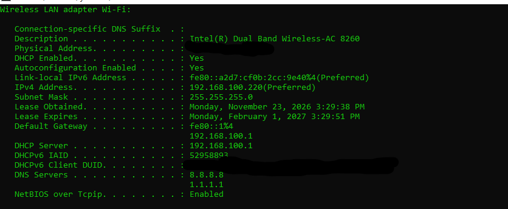
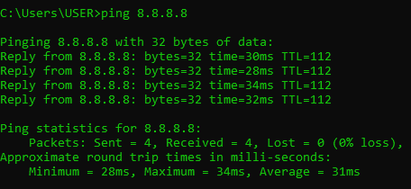
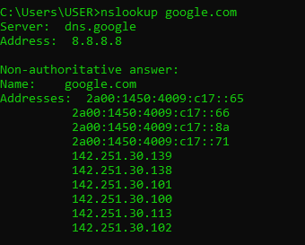
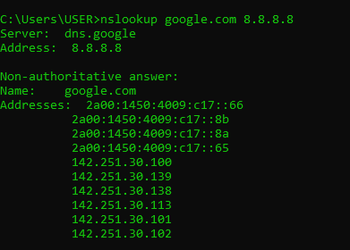
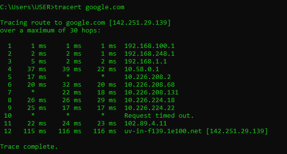

# Windows Network Troubleshooting Lab

## Project Overview

This project demonstrates practical network troubleshooting using built-in Windows command-line tools.

The exercises focus on checking network configuration, testing connectivity, investigating DNS resolution and examining the network path to a remote destination.

## Objectives

- Inspect network configuration.
- Test connectivity to a public IP address.
- Perform DNS lookup using the default DNS server.
- Compare DNS resolution using Google's public DNS server.
- Examine network routing using traceroute.
- Interpret diagnostic results and document findings.

## Tools Used

- Windows 10
- Command Prompt
- ipconfig
- ping
- nslookup
- tracert

## Practical Exercises

| Exercise | Command | Purpose |
|---|---|---|
| Network configuration | `ipconfig /all` | Inspect IP configuration, gateway and DNS settings |
| Connectivity test | `ping 8.8.8.8` | Test connectivity to Google's public DNS IP |
| DNS lookup | `nslookup google.com` | Check DNS resolution using the configured DNS server |
| Public DNS lookup | `nslookup google.com 8.8.8.8` | Query Google's public DNS server directly |
| Route tracing | `tracert google.com` | Examine the route taken to reach a destination |

## Findings and Observations

- The laptop successfully obtained an IPv4 address and default gateway through DHCP.
- The ping test to `8.8.8.8` completed with 0% packet loss.
- DNS queries successfully resolved `google.com` using both the configured DNS server and Google's public DNS server.
- The traceroute completed, although one intermediate hop did not respond to the probe.
- The tests demonstrated successful connectivity and DNS resolution during the exercise.

## Troubleshooting Interpretation

The results did not reveal an active connectivity or DNS failure during testing.

A non-responsive intermediate traceroute hop does not necessarily indicate a network fault, as some routers filter or limit responses to traceroute probes.

## Screenshots and Evidence

### 1. Network Configuration

### 2. Connectivity Test

### 3. DNS Lookup – Default DNS Server

### 4. DNS Lookup – Google Public DNS

### 5. Traceroute
.

## Limitations

This was a controlled diagnostic exercise using the laptop's existing internet connection. No actual network outage or fault was identified or resolved.

## Key Learning Outcomes

- Understanding basic Windows network configuration.
- Using command-line tools for network diagnostics.
- Interpreting IP addressing and gateway information.
- Understanding DNS resolution and public DNS queries.
- Reading traceroute results and identifying possible filtering.

## Project Status

Completed
